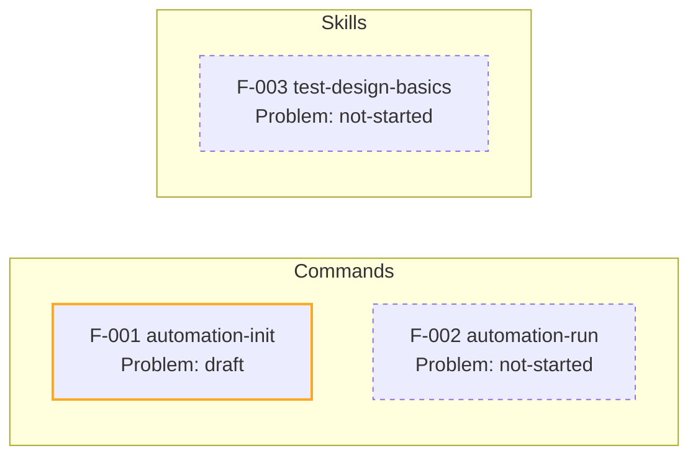

<!-- Generated by scripts/registry.mjs from registry.json. Do not edit by hand. -->

# Component map

agensdet's features and who uses whom. An arrow from A to B means A uses B.

Border: green = ready or released, yellow = in progress, dashed = not started.

## Orphans

Features nothing uses and no workflow includes.

None.
