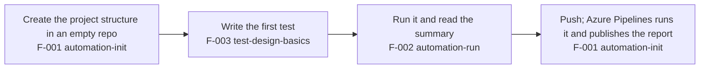

<!-- Generated by scripts/registry.mjs from registry.json. Do not edit by hand. -->

# Workflow view

The plugin's main user journeys. A step no feature covers is a gap.

## First test to CI (v0.1 release check)

